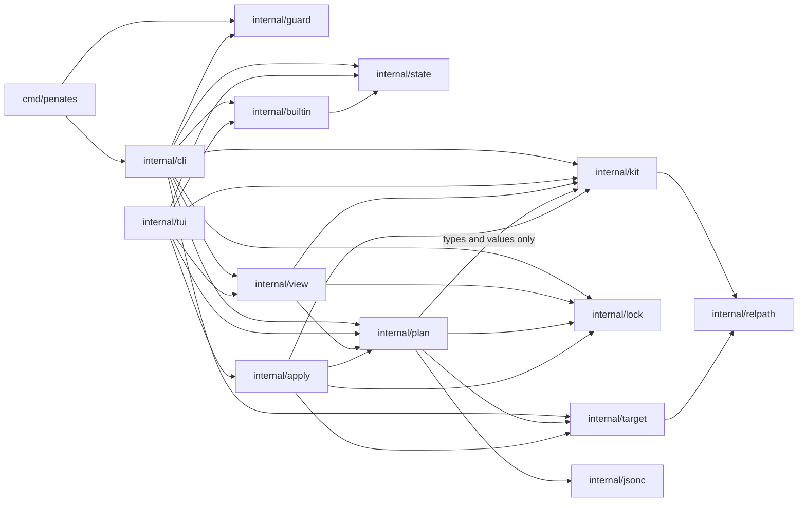

# penates architecture

This document records the technology stack, the architecture, and the project structure
of penates, with their rationale. It changes when the stack, the modules, their
interactions, or the top-level structure change. The behaviour of the product — the kit
format, ownership and conflict rules, updates, removal — is specified in
[concept.md](concept.md), referred to below as "the concept"; this document does not
repeat it.

The name was checked on 2026-11-04: free on npm, Homebrew core, and pkg.go.dev; GitHub
holds no notable project named penates.

## Tech Stack

| Area | Choice | Rationale |
|---|---|---|
| Language and distribution | Go 1.27, single static binary | Fixed by the concept's goals. Cross-compiles to Windows, Linux, and macOS without runtime dependencies. |
| TUI | [Bubble Tea](https://github.com/charmbracelet/bubbletea) with `bubbles` and `lipgloss` | The screens are forms and lists driven by application state (register target, select items, apply); the update/view loop models this directly. `tview` targets widget-heavy dashboards and pulls a larger dependency graph; `tcell` alone would mean hand-rolling lists and inputs. |
| Command line | [cobra](https://github.com/spf13/cobra) | The binary takes subcommands — `version` today, `licenses` next — beside the argument-free TUI. Cobra owns the command tree, the help, and shell completion; what it lacks — the one-line `Error:` contract and the suggestion wording — penates implements on top of it. Hand-rolled parsing would carry all of that again per command. |
| YAML | [goccy/go-yaml](https://github.com/goccy/go-yaml) | Actively maintained; decode errors carry positions, which validation messages shown to the kit author need. The frozen `gopkg.in/yaml.v3` continues as `go.yaml.in/yaml/v3` under Go-team stewardship; a swap was reviewed on 2026-11-08 and not taken. |
| JSONC | [hujson](https://github.com/tailscale/hujson) wrapped by `internal/jsonc` | Parses JSONC into a comment-preserving value tree and re-emits it, which partial edits of shared files require (concept: json contributions). The wrapper edits the tree in place, so parts no edit touched pack back byte for byte; hujson's own patch pipeline recommends reformatting the whole file and would not preserve the original bytes. |
| Version ordering | `golang.org/x/mod/semver` | Canonical implementation; the concept needs version comparison only. |
| Tests | standard `testing` + [`go-cmp`](https://github.com/google/go-cmp) | Table-driven tests; `go-cmp` for readable diffs of plans, locks, and snapshots. |
| Lint and format | `golangci-lint` with `gofmt` and `goimports` | One runner for vet, staticcheck, revive, gosec, and formatting; enforced in CI through `make check`. |
| CI | GitHub Actions | `make check` on Linux — the same target a developer runs, so local and CI results cannot diverge; `go test` additionally on a macOS/Windows matrix (Windows is a first-class platform in the concept); a secret scan with gitleaks. |
| License | MIT | Small permissive default for a public Go tool; nothing in the design binds to a larger obligation. |

Known risks:

- `internal/jsonc` inserts and removes members through hujson's value tree and
  packs untouched parts back byte for byte. Two choices are heuristic: a new
  member or element takes the line layout of its neighbor (two-space indent on
  a new line when the composite is empty), and a comment sitting between a
  removed member and its neighbor is removed with it, because the parser
  attaches it to the neighbor. Golden tests with realistic fixtures pin the
  output; if the choices prove unacceptable in practice, the fallback is a
  configurable formatter behind the same interface.
- `to` paths are slash-separated data (concept: items). They are converted to platform paths
  only at the file-system boundary, in `internal/target` and `internal/apply`; the
  Windows leg of the CI matrix guards the conversion.
- Concurrent runs over the one state file were the last open risk: the run guard
  (`internal/guard`) closed it — a second penates process is refused before it can
  touch the state, and a process's death releases the hold on its own. The residual
  limitation is deliberate: every command that opens the state refuses while the
  terminal UI is open, the reading ones included — the reading path writes too (the
  startup sync, the registry's prune-save), and a shorter hold (shared locks for
  readers, or the guard only around mutations with the lock re-read before each apply)
  means rewriting the terminal client's threading. That stays the direction for after
  the TUI rewrite.

### Dependency register

Every direct dependency of `go.mod`, in the file's order, with the notes the review of
2026-11-08 left on it. Indirect dependencies follow from these and are covered by the
license gate. Adding or replacing a direct dependency follows the Dependencies rule in
[CONTRIBUTING.md](../CONTRIBUTING.md) and updates this register in the same commit.

| Module | Scope | License | Notes |
|---|---|---|---|
| `github.com/charmbracelet/bubbles` | production | MIT | Used for `textinput` only. v1.0.0 is the final feature release: the component set is frozen upstream — stable, not abandoned. |
| `github.com/charmbracelet/bubbletea` | production | MIT | The TUI runtime the whole interface is built on; the de-facto standard Go TUI framework, backed by Charm. Replacing it means rewriting the interface. |
| `github.com/charmbracelet/lipgloss` | production | MIT | Palette and color rendering of the visual language, including profile degradation and NO_COLOR; one production file (`internal/tui/visual.go`). |
| `github.com/charmbracelet/x/ansi` | production | MIT | Display-width measurement, truncation, and wrapping. The v0.x line may still change its API between minor versions. |
| `github.com/goccy/go-yaml` | production | MIT | Decodes kit manifests; the swap to `go.yaml.in/yaml/v3` was reviewed on 2026-11-08 and not taken. |
| `github.com/google/go-cmp` | tests | BSD-3-Clause | Readable diffs of plans, locks, and snapshots; not linked into the release binary. |
| `github.com/mattn/go-isatty` | production | MIT | Whether stdin holds a terminal, for the CLI's confirmation model — a mutating command without `--yes` asks only on a terminal and refuses otherwise (concept 10.3). The stdlib way, `os.Stdin.Stat()` with `ModeCharDevice`, misreads a character device such as `/dev/null` as a terminal, and prompting into it would end the run on an empty answer. Already reached indirectly through `termenv` before; now linked directly. Maintained by mattn as part of the terminal stack the TUI builds on. |
| `github.com/muesli/termenv` | tests | MIT | Direct only so tests can force color profiles; production code reaches it through lipgloss. Maintenance mode upstream; `charmbracelet/colorprofile` is its successor. |
| `github.com/spf13/cobra` | production | Apache-2.0 | Command tree, help, suggestions, and shell completion. The tree of both built-in commands and the CLI client lives here — `internal/cli`, with `cmd/penates` as the entry — and the surface grew with the second client: command groups and per-command flags on top of the bare tree the TUI-only binary had. |
| `github.com/tailscale/hujson` | production | BSD-3-Clause | The JSONC parser behind `internal/jsonc`; the reference implementation of the JWCC format, from Tailscale. No tagged releases: the version is a pseudo-version pinned by `go.sum`. |
| `golang.org/x/mod` | production | BSD-3-Clause | The `semver` package only: version ordering for kits. |

## Architecture

The core produces and applies plans; clients render them. The concept fixes two
clients of equal capability — the CLI for AI agents and automation, the TUI for
humans.

### Modules

| Package | Responsibility |
|---|---|
| `cmd/penates` | Process entry: the build stamp, the streams, and the TUI runner handed to `internal/cli`, and the TUI opened over the data directory. No logic. |
| `internal/licenses` | The license texts of the code linked into the binary: penates and the Go distribution embedded as values, the third-party modules of the release platform embedded per platform by the release build — a PLACEHOLDER keeps every platform directory in the other builds. `Text` assembles the output of `penates licenses`; the third-party set is optional, and its absence is stated. |
| `internal/builtin` | The documentation kit penates ships inside the binary: the kit files embedded under `kit/`, and the startup sync that unpacks them into the data directory, keeps the copy in step with the embedded content by the three-state model (concept: the built-in kit), and registers the kit under its reserved name while it is free. The package knows no harness — the kit's own data carries the target hint and the install destinations. |
| `internal/kit` | Reads kit directories — `kit.yaml`, items, `item.yaml`, contribution declarations — and validates everything the concept requires of kit data: id syntax, version, source and target path rules, shared-file targets. Emits validation errors with positions. Read is tolerant: an item whose declaration has problems stays in the kit with its problems attached, and planning skips it; Load keeps the strict contract on top. |
| `internal/state` | Application state (concept: application state): the registry — kits, targets, the attachments between them, the last active target — and the per-target pending actions with their deferred operations and variable answers. The operations over the registry — attach, detach, edit kit path, forget target — keep its invariants, and every mutation saves; a state file of another format version is refused with the path to delete. The operations receive the lock facts they need — the item keys of a target's lock — as values and delete a lock through a one-method interface, so the package keeps no dependency on internal/lock. Persists under `~/.config/penates`, honoring `XDG_CONFIG_HOME`. Until the TUI rewrite, the current TUI reads the registry through a compatibility view. |
| `internal/guard` | The run guard: one exclusive lock per penates process over the penates data directory, held on the file `<dataDir>/penates.lock` — `flock` on Unix, `LockFileEx` on Windows, only the standard library. The clients take it before the first access to the directory and keep it until the process ends; an overlapping run is refused at once, under the CLI's `busy` category. The hold spans the whole run because the clients keep their lock objects in memory across it, so short locks cannot stop two runs that each saved a "whole" file from merging silently (concept: application state). Refuse, not wait: the hold spans an interactive session, and a waiting script would block for as long as a person keeps the interface open. |
| `internal/lock` | The per-target lock (concept: application state): reading, writing, and deleting the lock, and ownership queries over files, directories, sections, JSON locations, and shared files created by penates. |
| `internal/relpath` | The shared validity rule for the relative slash-separated paths of the domain — kit-declared contribution paths and paths inside the target — as one `Valid` predicate. Knows no file system. |
| `internal/target` | Reads the target directory into a snapshot: file existence, content hashes, and the structure of shared files — Markdown block layout and JSONC trees. All target I/O lives here. |
| `internal/markdown` | Pure text manipulation over managed blocks in shared Markdown files: parses the block layout and performs the append, replace, and removal operations section contributions are planned and removed with (concept: section contributions, removal). Knows no file system. |
| `internal/jsonc` | Pure editing of JSONC documents: get, insert, replace, and remove object members and array elements by RFC 6901 JSON Pointer, preserving comments and formatting of untouched parts (concept: json contributions). Knows no file system. |
| `internal/plan` | Pure decision making: kits, lock, snapshot, and selection in; a plan out — actions per item with reasons, the exclusions of items with plain reasons and conflicts among them, the conflicts as structure — the contribution kind, the file, block, or JSON location, and the owning installed item —, the answers the plan used, and the JSON locations each item owns. Implements the rules the concept specifies: the three-state conflict model, the per-location table for json contributions, the cross-item conflicts, the variable substitution and required-variable rule, the version table for updates with reset to kit on request, the reconciliation of the lock with the target by recorded hashes, and the removal of installed items. Performs no I/O. |
| `internal/apply` | Executes a plan as steps: every step applies or removes one item completely or not at all, writes atomically (temp file and rename), and the lock records only completed items. The per-item steps are the exposed unit; Apply and Remove are compositions over them that report the start and the result of every step, so a client can show per-item progress. After an interruption the package reconciles the lock with the target by removing the staged temp files and running the plan-side verdict over the snapshot (concept: atomicity, removal). |
| `internal/view` | The one decision both clients render: the state of every item, decided once from the kit item, its lock record, the lock-vs-target reconciliation, and the planner's verdict, with the prose of conflicts and exclusions beside it. The TUI renders a state as a glyph and a color, the CLI as a state word — one decision, two renderings, so the words and the glyphs cannot drift apart. Performs no I/O. |
| `internal/tui` | The Bubble Tea client: the main screen — the tree of kits and items rendered through the layout and the visual language of the spec, the details pane and view, the filter, the add-kit input, the apply summary, form, and results (concept: interfaces). The states it shows are the ones internal/view decides, rendered as glyphs. The only package that knows about the terminal. |
| `internal/cli` | The command-line client: the cobra command tree and the client behavior — the reading commands (`status`, `show`, `kit list`, `target list`), the `Error [category]: message` contract with its exit codes, and the flags-after-the-command-path rule (concept: interfaces). Imported by nothing but `cmd/penates`. |

### Dependencies



Rules:

- `internal/plan` imports no package that performs I/O; it receives kits, lock content,
  and the snapshot as values. Both clients reuse the core unchanged.
- No package knows any harness (a concept principle): destination paths come from kit data only.
- `internal/state` knows nothing of the run guard: it stays a pure persistence layer,
  and the clients take the guard through `internal/guard` before they open the store.
- `internal/tui` is imported by nothing.
- `internal/cli` is imported by nothing but `cmd/penates`; the runner of the TUI is
  injected into it, so the two clients never import each other.

### Data flow

1. **Startup sync.** Before any of it runs, the client takes the run guard —
   one penates process at a time works on a data directory. Then
   `internal/builtin` brings the unpacked built-in kit in step with the binary
   (concept: the built-in kit) and registers it while the name is free; the
   report rides into the model.
2. **Load.** The state names the registered kits; `internal/kit` reads them;
   `internal/target` reads the snapshot; `internal/lock` reads the lock.
3. **Plan.** The lock is reconciled with the target by recorded hashes first
   (concept: atomicity): the staged files of an interrupted apply are removed, and the
   modified and broken items are known. Then `internal/plan` turns selection
   plus inputs into per-item actions and errors; the client shows the summary
   (concept: interfaces) and collects missing input.
4. **Apply.** `internal/apply` processes items one at a time: validate the item's
   contributions against the target, write through temp files, record the item in the
   lock. Removals planned from the lock (concept: removal) run before the installs, and the
   installs plan from the target as the removals leave it. An interruption leaves the
   lock without the item; the next run reconciles the lock with the target using
   recorded hashes.

### Security checklist

- The trust boundary runs around three inputs: kit directories, the target directory,
  and the state directory. Kit YAML is parsed with strict decoders and validated before
  anything is planned; target content is parsed no further than Markdown block markers
  and JSONC. Nothing from a kit is ever executed.
- penates performs no network access (a concept non-goal); writes touch only the target
  and state directories, and every write path derives from a validated `to` path.
- Variable answers are stored in the state directory. Secrets are out of scope by
  design (concept: variables), and variable values appear only in the interfaces'
  own output — TUI screens and CLI command output — never in logs or errors.
- No tokens, credentials, or personal paths appear in logs or error messages.

## Project Structure

```
penates/
├── cmd/penates/          # main package
├── internal/             # one package per module: kit, state, guard, lock, target, relpath, plan, apply, view, tui, cli, licenses, builtin
├── docs/                 # the concept, this document, and the archive
└── .github/workflows/    # CI
```

`internal/` keeps the core unimportable while its API settles; the boundary mirrors the
client/core split — a second client is a package under `internal/`, and `cmd/` stays a
process entry. The repository root holds `go.mod`, `Makefile`, `.golangci.yml`, `README.md`,
`CHANGELOG.md`, `LICENSE`, and `.gitignore`.
