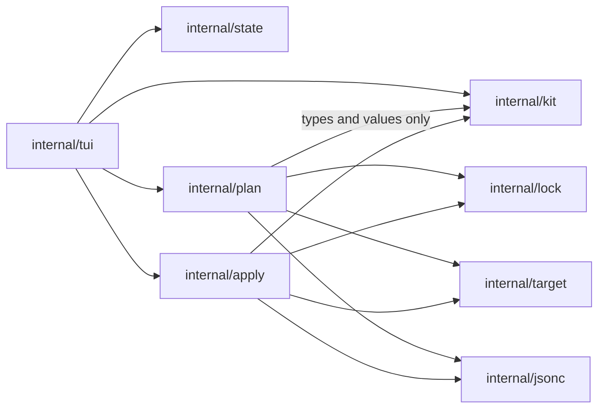

# penates architecture

This document records the technology stack, the architecture, and the project structure
of penates, with their rationale. It changes when the stack, the modules, their
interactions, or the top-level structure change. The behaviour of the product — the kit
format, ownership and conflict rules, updates, removal — is specified in
[rfc-penates.md](rfc-penates.md), referred to below as "the RFC"; this document does not
repeat it.

The name was checked on 2026-11-04: free on npm, Homebrew core, and pkg.go.dev; GitHub
holds no notable project named penates (RFC, open question 1).

## Tech Stack

| Area | Choice | Rationale |
|---|---|---|
| Language and distribution | Go 1.27, single static binary | Fixed by the RFC (section 11). Cross-compiles to Windows, Linux, and macOS without runtime dependencies. |
| TUI | [Bubble Tea](https://github.com/charmbracelet/bubbletea) with `bubbles` and `lipgloss` | The screens are forms and lists driven by application state (register target, select items, apply); the update/view loop models this directly. `tview` targets widget-heavy dashboards and pulls a larger dependency graph; `tcell` alone would mean hand-rolling lists and inputs. |
| YAML | [goccy/go-yaml](https://github.com/goccy/go-yaml) | Actively maintained; decode errors carry positions, which validation messages shown to the kit author need. `gopkg.in/yaml.v3` is frozen upstream. |
| JSONC | [hujson](https://github.com/tailscale/hujson) wrapped by `internal/jsonc` | Parses JSONC into a comment-preserving value tree and re-emits it, which partial edits of shared files require (RFC 7.4). The wrapper edits the tree in place, so parts no edit touched pack back byte for byte; hujson's own patch pipeline recommends reformatting the whole file and would not preserve the original bytes. |
| Version ordering | `golang.org/x/mod/semver` | Canonical implementation; the RFC needs comparison only (section 8). |
| Tests | standard `testing` + [`go-cmp`](https://github.com/google/go-cmp) | Table-driven tests; `go-cmp` for readable diffs of plans, locks, and snapshots. |
| Lint and format | `golangci-lint` with `gofmt` and `goimports` | One runner for vet, staticcheck, revive, gosec, and formatting; enforced in CI through `make check`. |
| CI | GitHub Actions | `make check` on Linux — the same target a developer runs, so local and CI results cannot diverge; `go test` additionally on a macOS/Windows matrix (Windows is first-class, RFC 4); a secret scan with gitleaks. |
| License | MIT | Small permissive default for a public Go tool; nothing in the design binds to a larger obligation. |

Known risks:

- `internal/jsonc` inserts and removes members through hujson's value tree and
  packs untouched parts back byte for byte. Two choices are heuristic: a new
  member or element takes the line layout of its neighbor (two-space indent on
  a new line when the composite is empty), and a comment sitting between a
  removed member and its neighbor is removed with it, because the parser
  attaches it to the neighbor. Golden tests with realistic fixtures pin the
  output; if the choices prove unacceptable in practice, the fallback is a
  configurable formatter behind the same interface.
- `to` paths are slash-separated data (RFC 6.2). They are converted to platform paths
  only at the file-system boundary, in `internal/target` and `internal/apply`; the
  Windows leg of the CI matrix guards the conversion.

## Architecture

The core produces and applies plans; clients render them (RFC 11). In v1 the TUI is the
only client.

### Modules

| Package | Responsibility |
|---|---|
| `cmd/penates` | Process entry: argument handling, wiring, running the TUI. No logic. |
| `internal/kit` | Reads kit directories — `kit.yaml`, items, `item.yaml`, contribution declarations — and validates everything the RFC requires of kit data: id syntax, version, source and target path rules, shared-file targets. Emits validation errors with positions. |
| `internal/state` | Application state (RFC 6.7): registered kits and targets, the kit-to-target mapping, the last selection, variable answers. Persists under `os.UserConfigDir()/penates`. |
| `internal/lock` | The per-target lock (RFC 6.7): read, write, and ownership queries over files, directories, sections, JSON locations, and shared files created by penates. |
| `internal/target` | Reads the target directory into a snapshot: file existence, content hashes, and the structure of shared files — Markdown block layout and JSONC trees. All target I/O lives here. |
| `internal/markdown` | Pure text manipulation over managed blocks in shared Markdown files: parses the block layout and performs the append and replace operations section contributions are planned with (RFC 7.3). Knows no file system. |
| `internal/jsonc` | Pure editing of JSONC documents: get, insert, replace, and remove object members and array elements by RFC 6901 JSON Pointer, preserving comments and formatting of untouched parts (RFC 7.4). Knows no file system. |
| `internal/plan` | Pure decision making: kits, lock, snapshot, and selection in; a plan out — actions per item with reasons, errors per item. Implements the three-state conflict model (RFC 7). Performs no I/O. |
| `internal/apply` | Executes a plan: applies an item completely or not at all, writes atomically (temp file and rename), updates the lock on success, reconciles after an interruption (RFC 7.7). |
| `internal/tui` | The Bubble Tea client: registration, item list, variable forms, apply summary (RFC 10). The only package that knows about the terminal. |

### Dependencies



Rules:

- `internal/plan` imports no package that performs I/O; it receives kits, lock content,
  and the snapshot as values. A future command-line client reuses the core unchanged.
- No package knows any harness (RFC 4): destination paths come from kit data only.
- `internal/tui` is imported by nothing.

### Data flow

1. **Load.** The state names the registered kits; `internal/kit` reads them;
   `internal/target` reads the snapshot; `internal/lock` reads the lock.
2. **Plan.** `internal/plan` turns selection plus inputs into per-item actions and
   errors; the TUI shows the summary (RFC 10.2) and collects missing input.
3. **Apply.** `internal/apply` processes items one at a time: validate the item's
   contributions against the target, write through temp files, record the item in the
   lock. An interruption leaves the lock without the item; the next run reconciles the
   lock with the target using recorded hashes (RFC 7.7).

### Security checklist

- The trust boundary runs around three inputs: kit directories, the target directory,
  and the state directory. Kit YAML is parsed with strict decoders and validated before
  anything is planned; target content is parsed no further than Markdown block markers
  and JSONC. Nothing from a kit is ever executed.
- penates performs no network access (RFC 3.2); writes touch only the target and state
  directories, and every write path derives from a validated `to` path.
- Variable answers are stored in the state directory. Secrets are out of scope by
  design (RFC 6.4), and no output beyond the TUI screens prints variable values.
- No tokens, credentials, or personal paths appear in logs or error messages.

## Project Structure

```
penates/
├── cmd/penates/          # main package
├── internal/             # one package per module: kit, state, lock, target, plan, apply, tui
├── docs/                 # the RFC and this document
└── .github/workflows/    # CI
```

`internal/` keeps the core unimportable while its API settles; the boundary mirrors the
client/core split — a second client adds a directory under `cmd/` and touches nothing
else. The repository root holds `go.mod`, `Makefile`, `.golangci.yml`, `README.md`,
`CHANGELOG.md`, `LICENSE`, and `.gitignore`.
