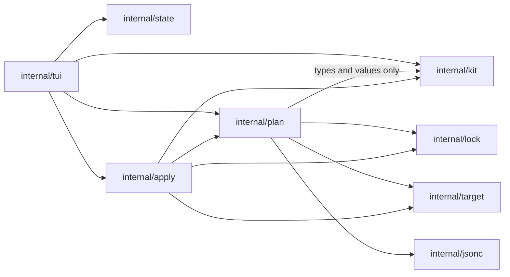

# penates architecture

This document records the technology stack, the architecture, and the project structure
of penates, with their rationale. It changes when the stack, the modules, their
interactions, or the top-level structure change. The behaviour of the product — the kit
format, ownership and conflict rules, updates, removal — is specified in
[concept.md](concept.md), referred to below as "the concept"; this document does not
repeat it.

The name was checked on 2026-11-04: free on npm, Homebrew core, and pkg.go.dev; GitHub
holds no notable project named penates.

## Tech Stack

| Area | Choice | Rationale |
|---|---|---|
| Language and distribution | Go 1.27, single static binary | Fixed by the concept's goals. Cross-compiles to Windows, Linux, and macOS without runtime dependencies. |
| TUI | [Bubble Tea](https://github.com/charmbracelet/bubbletea) with `bubbles` and `lipgloss` | The screens are forms and lists driven by application state (register target, select items, apply); the update/view loop models this directly. `tview` targets widget-heavy dashboards and pulls a larger dependency graph; `tcell` alone would mean hand-rolling lists and inputs. |
| Command line | [cobra](https://github.com/spf13/cobra) | The binary takes subcommands — `version` today, `licenses` next — beside the argument-free TUI. Cobra owns the command tree, the help, and shell completion; what it lacks — the one-line `Error:` contract and the suggestion wording — penates implements on top of it. Hand-rolled parsing would carry all of that again per command. |
| YAML | [goccy/go-yaml](https://github.com/goccy/go-yaml) | Actively maintained; decode errors carry positions, which validation messages shown to the kit author need. `gopkg.in/yaml.v3` is frozen upstream. |
| JSONC | [hujson](https://github.com/tailscale/hujson) wrapped by `internal/jsonc` | Parses JSONC into a comment-preserving value tree and re-emits it, which partial edits of shared files require (concept: json contributions). The wrapper edits the tree in place, so parts no edit touched pack back byte for byte; hujson's own patch pipeline recommends reformatting the whole file and would not preserve the original bytes. |
| Version ordering | `golang.org/x/mod/semver` | Canonical implementation; the concept needs version comparison only. |
| Tests | standard `testing` + [`go-cmp`](https://github.com/google/go-cmp) | Table-driven tests; `go-cmp` for readable diffs of plans, locks, and snapshots. |
| Lint and format | `golangci-lint` with `gofmt` and `goimports` | One runner for vet, staticcheck, revive, gosec, and formatting; enforced in CI through `make check`. |
| CI | GitHub Actions | `make check` on Linux — the same target a developer runs, so local and CI results cannot diverge; `go test` additionally on a macOS/Windows matrix (Windows is a first-class platform in the concept); a secret scan with gitleaks. |
| License | MIT | Small permissive default for a public Go tool; nothing in the design binds to a larger obligation. |

Known risks:

- `internal/jsonc` inserts and removes members through hujson's value tree and
  packs untouched parts back byte for byte. Two choices are heuristic: a new
  member or element takes the line layout of its neighbor (two-space indent on
  a new line when the composite is empty), and a comment sitting between a
  removed member and its neighbor is removed with it, because the parser
  attaches it to the neighbor. Golden tests with realistic fixtures pin the
  output; if the choices prove unacceptable in practice, the fallback is a
  configurable formatter behind the same interface.
- `to` paths are slash-separated data (concept: items). They are converted to platform paths
  only at the file-system boundary, in `internal/target` and `internal/apply`; the
  Windows leg of the CI matrix guards the conversion.

## Architecture

The core produces and applies plans; clients render them. In v1 the TUI is the
only client.

### Modules

| Package | Responsibility |
|---|---|
| `cmd/penates` | Process entry: the cobra command tree, wiring, running the TUI. No logic. |
| `internal/licenses` | The license texts of the code linked into the binary: penates and the Go distribution embedded as values, the third-party modules of the release platform embedded per platform by the release build — a PLACEHOLDER keeps every platform directory in the other builds. `Text` assembles the output of `penates licenses`; the third-party set is optional, and its absence is stated. |
| `internal/kit` | Reads kit directories — `kit.yaml`, items, `item.yaml`, contribution declarations — and validates everything the concept requires of kit data: id syntax, version, source and target path rules, shared-file targets. Emits validation errors with positions. |
| `internal/state` | Application state (concept: application state): the registry — kits, targets, the attachments between them, the last active target — and the per-target pending actions with their deferred operations and variable answers. The operations over the registry — attach, detach, edit kit path, forget target — keep its invariants, and every mutation saves; a state file of another format version is refused with the path to delete. The operations receive the lock facts they need — the item keys of a target's lock — as values and delete a lock through a one-method interface, so the package keeps no dependency on internal/lock. Persists under `~/.config/penates`, honoring `XDG_CONFIG_HOME`. Until the TUI rewrite, the current TUI reads the registry through a compatibility view. |
| `internal/lock` | The per-target lock (concept: application state): reading, writing, and deleting the lock, and ownership queries over files, directories, sections, JSON locations, and shared files created by penates. |
| `internal/target` | Reads the target directory into a snapshot: file existence, content hashes, and the structure of shared files — Markdown block layout and JSONC trees. All target I/O lives here. |
| `internal/markdown` | Pure text manipulation over managed blocks in shared Markdown files: parses the block layout and performs the append, replace, and removal operations section contributions are planned and removed with (concept: section contributions, removal). Knows no file system. |
| `internal/jsonc` | Pure editing of JSONC documents: get, insert, replace, and remove object members and array elements by RFC 6901 JSON Pointer, preserving comments and formatting of untouched parts (concept: json contributions). Knows no file system. |
| `internal/plan` | Pure decision making: kits, lock, snapshot, and selection in; a plan out — actions per item with reasons, the exclusions of items with plain reasons and conflicts among them, the conflicts as structure — the contribution kind, the file, block, or JSON location, and the owning installed item —, the answers the plan used, and the JSON locations each item owns. Implements the rules the concept specifies: the three-state conflict model, the per-location table for json contributions, the cross-item conflicts, the variable substitution and required-variable rule, the version table for updates with reset to kit on request, the reconciliation of the lock with the target by recorded hashes, and the removal of installed items. Performs no I/O. |
| `internal/apply` | Executes a plan as steps: every step applies or removes one item completely or not at all, writes atomically (temp file and rename), and the lock records only completed items. The per-item steps are the exposed unit; Apply and Remove are compositions over them that report the start and the result of every step, so a client can show per-item progress. After an interruption the package reconciles the lock with the target by removing the staged temp files and running the plan-side verdict over the snapshot (concept: atomicity, removal). |
| `internal/tui` | The Bubble Tea client: the main screen — the tree of kits and items rendered through the layout and the visual language of the spec, the details pane and view, the filter, the add-kit input, the apply summary, form, and results (concept: user experience). The only package that knows about the terminal. |

### Dependencies



Rules:

- `internal/plan` imports no package that performs I/O; it receives kits, lock content,
  and the snapshot as values. A future command-line client reuses the core unchanged.
- No package knows any harness (a concept principle): destination paths come from kit data only.
- `internal/tui` is imported by nothing.

### Data flow

1. **Load.** The state names the registered kits; `internal/kit` reads them;
   `internal/target` reads the snapshot; `internal/lock` reads the lock.
2. **Plan.** The lock is reconciled with the target by recorded hashes first
   (concept: atomicity): the staged files of an interrupted apply are removed, and the
   modified and broken items are known. Then `internal/plan` turns selection
   plus inputs into per-item actions and errors; the TUI shows the summary
   (concept: user experience) and collects missing input.
3. **Apply.** `internal/apply` processes items one at a time: validate the item's
   contributions against the target, write through temp files, record the item in the
   lock. Removals planned from the lock (concept: removal) run before the installs, and the
   installs plan from the target as the removals leave it. An interruption leaves the
   lock without the item; the next run reconciles the lock with the target using
   recorded hashes.

### Security checklist

- The trust boundary runs around three inputs: kit directories, the target directory,
  and the state directory. Kit YAML is parsed with strict decoders and validated before
  anything is planned; target content is parsed no further than Markdown block markers
  and JSONC. Nothing from a kit is ever executed.
- penates performs no network access (a concept non-goal); writes touch only the target
  and state directories, and every write path derives from a validated `to` path.
- Variable answers are stored in the state directory. Secrets are out of scope by
  design (concept: variables), and no output beyond the TUI screens prints variable
  values.
- No tokens, credentials, or personal paths appear in logs or error messages.

## Project Structure

```
penates/
├── cmd/penates/          # main package
├── internal/             # one package per module: kit, state, lock, target, plan, apply, tui, licenses
├── docs/                 # the concept, this document, and the archive
└── .github/workflows/    # CI
```

`internal/` keeps the core unimportable while its API settles; the boundary mirrors the
client/core split — a second client adds a directory under `cmd/` and touches nothing
else. The repository root holds `go.mod`, `Makefile`, `.golangci.yml`, `README.md`,
`CHANGELOG.md`, `LICENSE`, and `.gitignore`.
